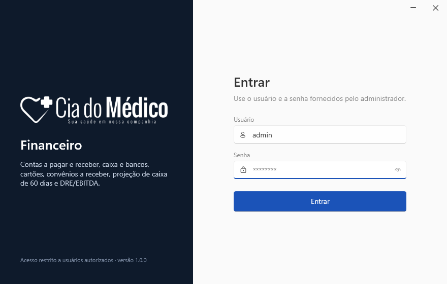
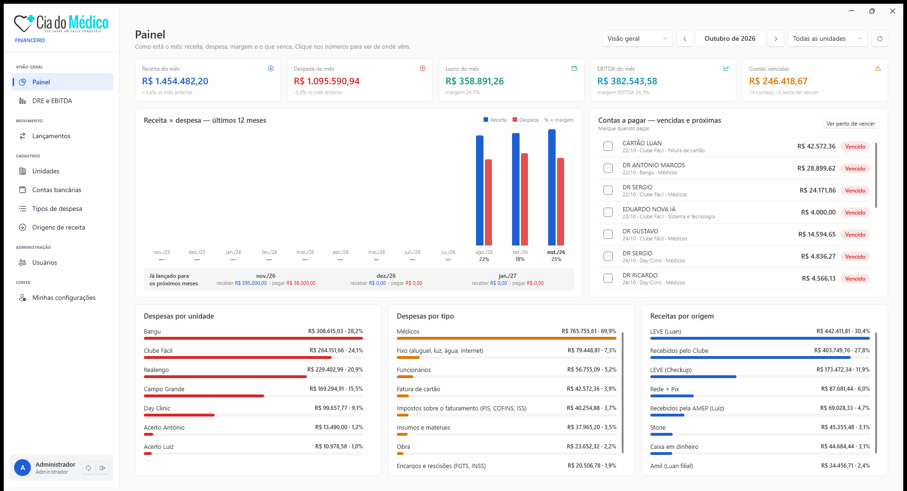
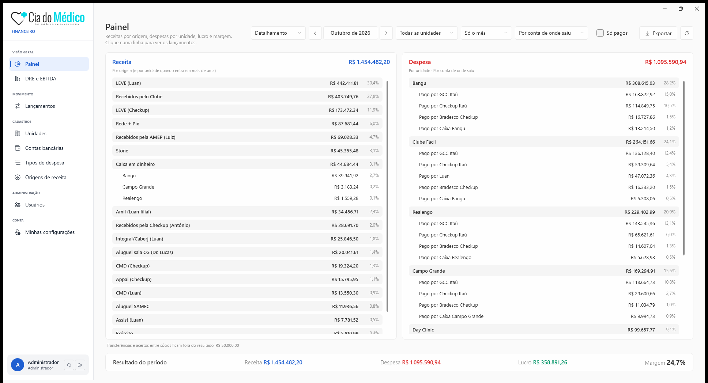
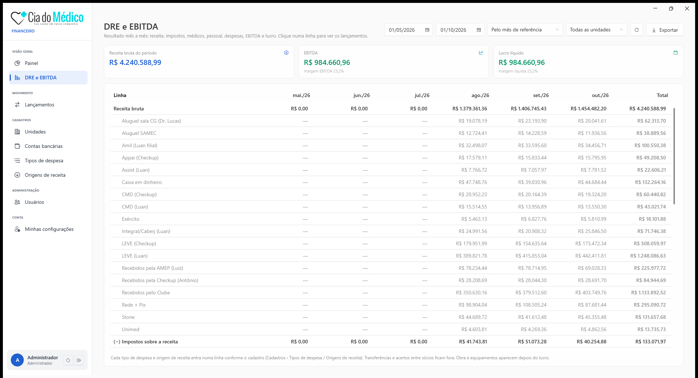
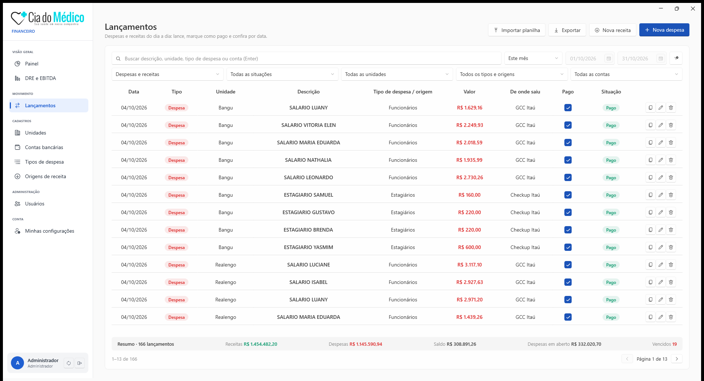
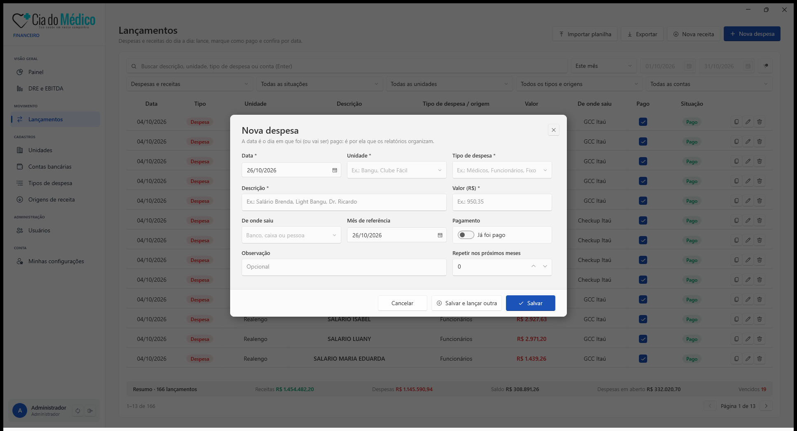
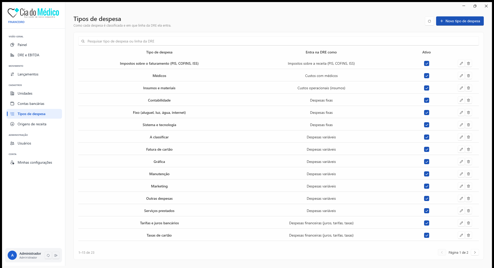
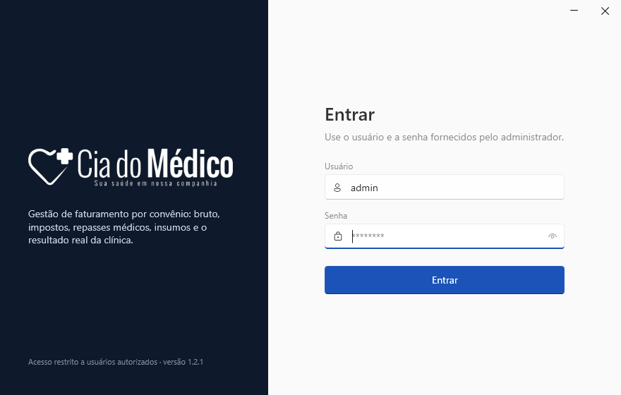

# Cia do Médico — Sistemas

Programas para Windows da Cia do Médico: **Financeiro** e **Repasses de Convênios**.

&nbsp;

Windows 10 ou 11 · cerca de 60 MB cada · todas as versões em <a href="https://github.com/technology-services-base44/cia-do-medico-sistemas/releases">Releases</a>

---

## Sumário

- [Como baixar e instalar](#como-baixar-e-instalar)
- [Primeiro acesso](#primeiro-acesso)
- [Financeiro](#financeiro)
- [Repasses de Convênios](#repasses-de-convênios)
- [Atualizações](#atualizações)
- [Problemas comuns](#problemas-comuns)

---

## Como baixar e instalar

Os dois programas instalam do mesmo jeito. Não precisa de instalador nem de permissão de administrador.

1. **Baixe** o programa no botão lá em cima (ou em [Releases](https://github.com/technology-services-base44/cia-do-medico-sistemas/releases)). Vem um arquivo `.zip`.
2. **Extraia** o zip: clique com o botão direito no arquivo → **Extrair tudo…** → escolha uma pasta fixa, por exemplo `Documentos`.
   > Não abra o programa de dentro do zip nem deixe na pasta Downloads (ela costuma ser limpa).
3. Abra a pasta extraída e dê **dois cliques** no programa:
   - Financeiro: `CiaDoMedico.Financeiro.exe`
   - Repasses de Convênios: `CiaDoMedico.Repasses.exe`
4. **(Opcional)** Para ter o atalho na área de trabalho: botão direito no `.exe` → **Mostrar mais opções** → **Enviar para** → **Área de trabalho (criar atalho)**.

> Deixe o arquivo `servidor.txt` na mesma pasta do `.exe`: é ele que diz ao programa onde fica o servidor da clínica.

---

## Primeiro acesso

1. Entre com o **usuário e a senha** que o administrador passou.
2. No primeiro login, o sistema pede para você **criar a sua senha** (mínimo de 8 caracteres).
3. Pronto: da próxima vez é só abrir o programa e entrar.

> Não tem usuário? Peça a um administrador: ele cria em **Administração › Usuários** (Financeiro).

---

## Financeiro

Substitui as planilhas do financeiro: lançamento das despesas e receitas do dia a dia, painel do mês, DRE/EBITDA e a visão de receitas, despesas, lucro e margem.

> As telas abaixo usam **dados de teste** (valores fictícios).

### Painel — visão geral

Receita, despesa, lucro, EBITDA e contas vencidas do mês; gráfico dos últimos 12 meses com a margem de cada mês; contas a pagar vencidas e próximas (marque como pago direto ali); despesas por unidade e por tipo e receitas por origem. **Clique em qualquer número** para ver os lançamentos que formam aquele valor. Use ◀ ▶ para trocar o mês.

### Painel — detalhamento

O resumo do mês no mesmo formato da planilha **MACRO**: cada origem de receita, as despesas de cada unidade (abertas pela conta de onde saiu ou pelo tipo de despesa) e, no fim, **receita, despesa, lucro e margem**. O botão **Exportar** gera a planilha nesse formato.

### DRE e EBITDA

Resultado mês a mês: receita bruta, impostos, médicos, pessoal, despesas fixas e variáveis, **EBITDA**, lucro líquido e as margens. Obra e equipamentos aparecem depois do lucro, como investimento. Clique numa linha para ver os lançamentos.

### Lançamentos

A lista de despesas e receitas (substitui a aba **Dados** da planilha), com busca e filtros por período, tipo, situação, unidade, tipo de despesa e conta. A caixinha **Pago** marca e desmarca na hora. Também dá para **importar a planilha do Excel** de uma vez e **exportar** a lista.

Para lançar, use **Nova despesa** ou **Nova receita**. A **data** é o dia em que foi (ou vai ser) pago — é por ela que os relatórios organizam. Para contas fixas, use **Repetir nos próximos meses**; para lançar várias seguidas, **Salvar e lançar outra**.

### Cadastros

Unidades, contas bancárias, tipos de despesa e origens de receita ficam em telas separadas, e qualquer usuário pode incluir, editar ou excluir. Em cada tipo de despesa você escolhe em que linha da DRE ele entra.

---

## Repasses de Convênios

Gestão do faturamento por convênio: importação das guias (XML TISS), bruto, impostos, repasses médicos, insumos e o resultado real da clínica, com fechamento por médico.

> Este sistema já está em uso com dados reais da clínica, por isso só a tela de entrada aparece aqui.

---

## Atualizações

Os programas se atualizam sozinhos: ao abrir, eles conferem se existe versão nova e, se tiver, baixam, instalam e reabrem. Também dá para conferir na hora pelo botão ↻ ao lado de **Sair**, no canto de baixo do menu.

Só precisa baixar de novo por aqui se for instalar num computador novo.

---

## Problemas comuns

<b>O Windows mostrou "O Windows protegeu o computador"</b>

O programa ainda não tem assinatura digital, então o Windows avisa na primeira vez. Clique em **Mais informações** → **Executar assim mesmo**.

<b>O programa não abre (nada acontece) ou aparece "Smart App Control bloqueou"</b>

O **Controle Inteligente de Aplicativos** do Windows 11 bloqueia programas sem assinatura digital. Fale com o suporte de TI da clínica para liberar o programa nesse computador.

<b>"Não foi possível conectar ao servidor"</b>

Confira a internet e se o arquivo `servidor.txt` está na mesma pasta do `.exe`. Se continuar, avise o suporte.

<b>Esqueci a senha</b>

Peça a um administrador para definir uma senha provisória em **Usuários**; no próximo acesso você cria uma nova.

---

Cia do Médico · Sua saúde em nossa companhia

